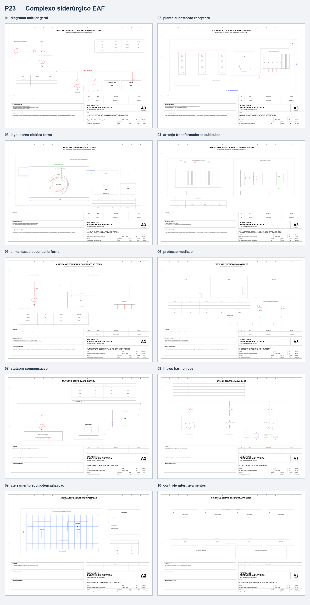

# Complexo siderúrgico com forno elétrico a arco (EAF)

Estudo **acadêmico e conceitual** para portfólio. Abrange recepção em 138 kV, distribuição em 34,5 kV, forno 30 MVA com secundário conceitual de 1 kV, compensação dinâmica, filtros harmônicos, proteção, aterramento e intertravamentos.

## Conteúdo

- 10 pranchas A3 em `fonte/` (DXF editável) e `exports/` (PDF, SVG e PNG).
- Memorial, critérios, memória de cálculo, referências e inspeção visual.
- Parâmetros centrais exportados de `portfolio.toml` para `dados/parametros.csv`.
- Análises MATLAB em `matlab/calculos/run_analysis.m`; resultados CSV e gráficos em `resultados/`.
- Recálculos independentes e teste dinâmico reduzido Python em `validacao/`; os oito cenários Python não são execução do Simulink.
- Modelo dinâmico Simulink: `modelo_eaf_dinamico.slx`.

## Reprodução

Execute `matlab/calculos/run_analysis.m` no MATLAB R2026a (ou versão compatível). Para reconstruir o modelo Simulink, execute `matlab/calculos/build_model.m`. A rotina de verificação local é `fonte/validar_projeto_23.py`. Gere novamente DXFs/derivados com `python fonte/gerar_projeto_23.py` a partir da raiz do repositório.

Sem MATLAB, recalcule os valores estáticos com `python 23-complexo-siderurgico-eaf/validacao/calculos_independentes_p23.py` e execute a alternativa reduzida de oito cenários com `python 23-complexo-siderurgico-eaf/validacao/simulacao_dinamica_python_p23.py`. Os testes são `python -m pytest 23-complexo-siderurgico-eaf/validacao -q`.

## Limites

Estudo de alimentação de uma aciaria elétrica com análise preliminar de demanda, corrente de curto-circuito, compensação reativa e espectro harmônico sintético. O conteúdo delimita premissas e interfaces para evolução do projeto; não seleciona fabricante, ajuste de relé, filtro ou equipamento de proteção.

Projeto acadêmico e conceitual. Não deve ser utilizado para fabricação, instalação ou execução de serviços sem revisão, dimensionamento e responsabilidade de profissional legalmente habilitado.
