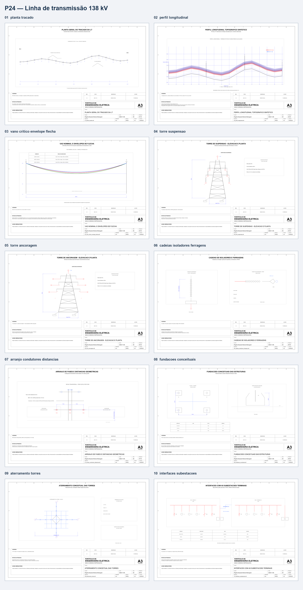

# P24 — Linha de transmissão 138 kV, 30 km

Estudo acadêmico e conceitual de uma linha aérea trifásica com corredor fictício, condutor CAA Drake 795 kcmil 26/7 e feixe duplo assumido por fase. As 10 pranchas editáveis DXF e derivados PDF/SVG/PNG ficam em `fonte/` e `exports/`.

## Conteúdo técnico

- `portfolio.toml`: parâmetros ajustáveis centrais.
- `dados/parametros.csv`: exportação com valor e unidade.
- `dados/origem-parametros.csv`: origem, classe e limitação de cada grupo de parâmetros.
- `matlab/calculos/run_analysis.m`: fluxo positivo-sequência em modelo nominal π, matriz 3×3 de cargas/fp, 900 cenários mecânicos, 9 ambientais e gráficos MATLAB opcionais.
- `matlab/testes/test_project_24.m`: verificações MATLAB para combinações, energia, estruturas, flechas, tração e ampacidade.
- `resultados/tabelas/`: fluxo, perfil de estruturas, flechas, deslocamentos transversais e ampacidade de triagem.
- `validacao/plotar_resultados_p24.py`: fallback de pouca memória que refaz a matriz mecânica simplificada e recria seis gráficos a partir dos parâmetros e tabelas.
- `validacao/test_resultados_p24.py`: testes independentes de consistência dos CSVs.
- `validacao/relatorio-validacao.json`: saída do validador estrutural do portfólio.
- `validacao/relatorio-validacao-tecnica.json`: execução, testes numéricos e limitações técnicas desta revisão.

## Reprodução

Para gerar tabelas e executar o teste MATLAB sem figuras: `R = run_analysis(false); test_project_24(R);`. Com memória disponível, `R = run_analysis(true); test_project_24(R);` também pede as seis figuras MATLAB; esse caminho não concluiu neste host. O fallback de gráficos e dos casos mecânicos é `python validacao/plotar_resultados_p24.py`, executado da raiz do repositório; os testes Python são `python -m pytest -q 24-linha-transmissao-138kv/validacao/test_resultados_p24.py`.

Os DXFs e derivados desta revisão foram regenerados por `python scripts/engineering_studies.py --project p24`. As pranchas estão marcadas `S/ESC.` porque são composições de folha; a escala gráfica H/V do perfil P24-02 tem exagero vertical de 100× e não deve ser usada para medir terreno ou clearance.

## Resultados de triagem

Para a matriz assumida, a maior corrente é 650,80 A (140 MW/fp 0,90); a ampacidade simplificada mínima do feixe duplo é 892,04 A a 45 °C e vento nulo, margem de 27,04%. O perfil sintético resultou em clearance vertical mínimo de 12,679 m; não inclui blowout lateral sobre terreno 2D. Leia `criterios-premissas.md` e `memoria-calculo.md` antes de interpretar os números.

## Limites

Não há topografia, clima, servidão, dados de fabricante completos do condutor/torres, estudo de curto-circuito, sequência zero, proteção, coordenação de isolamento, estrutura, fundação, grounding study, requisitos de acesso ou validação profissional. A rotina térmica é uma aproximação e não declara implementação conforme IEEE 738. O módulo axial e o coeficiente térmico são aproximações por tabela T-ACSR cuja equivalência ao CAA selecionado não foi confirmada. Nenhum resultado autoriza locação, fabricação, instalação, energização ou operação.

Não foi criado nem executado modelo Simulink para este projeto; não alegar simulação dinâmica.

Projeto acadêmico e conceitual. Não deve ser utilizado para fabricação, instalação ou execução de serviços sem revisão, dimensionamento e responsabilidade de profissional legalmente habilitado.
