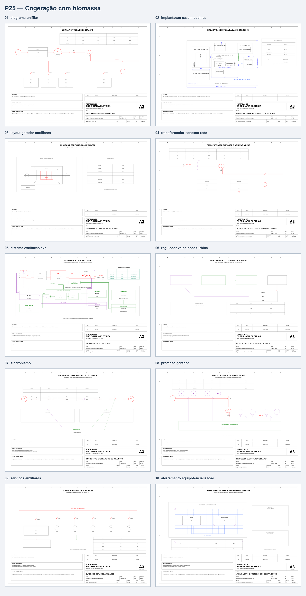

# Usina de cogeração a biomassa, 25 MW

Estudo **acadêmico e conceitual** para portfólio. Abrange gerador síncrono de 13,8 kV, conexão via transformador 40 MVA a 138 kV, AVR, governador, sincronismo, proteção, auxiliares, balanço de vapor e energia e aterramento.

## Conteúdo

- 10 pranchas A3 em `fonte/` (DXF editável) e `exports/` (PDF, SVG e PNG).
- Memorial, critérios, memória de cálculo, referências e inspeção visual.
- Parâmetros centrais exportados de `portfolio.toml` para `dados/parametros.csv`.
- Análises MATLAB em `matlab/calculos/run_analysis.m`; resultados CSV e gráficos em `resultados/`.
- Recalculo independente dos balanços estáticos em `validacao/calculos_independentes_p25.py`, com testes em `validacao/test_calculos_independentes_p25.py`.
- Alternativa dinâmica Python de oito cenários (8.008 amostras), com sinais de tensão, frequência, potência e corrente, em `validacao/simulacao_dinamica_python_p25.py`; a variação de potência é referência mecânica do governador, não degrau físico de carga nem execução do Simulink.
- Modelo dinâmico Simulink: `modelo_cogeracao_dinamico.slx`.

## Reprodução

Execute `python 25-usina-cogeracao-biomassa/validacao/calculos_independentes_p25.py` para regenerar os três balanços estáticos sem MATLAB; execute `python -m pytest -q 25-usina-cogeracao-biomassa/validacao/test_calculos_independentes_p25.py` para verificá-los. `matlab/calculos/run_analysis.m` recalcula os mesmos balanços e, por padrão, executa a série dinâmica existente no MATLAB R2026a (ou compatível). Para reconstruir o modelo Simulink, execute `matlab/calculos/build_model.m`. A rotina de verificação estrutural CAD é `fonte/validar_projeto_25.py`. Gere DXFs/derivados com `python scripts/engineering_studies.py --project p25` a partir da raiz.

Para reproduzir a alternativa dinâmica: `python 25-usina-cogeracao-biomassa/validacao/simulacao_dinamica_python_p25.py`. Os seis testes da série verificam eventos de entrada, sensibilidade ao passo e preservação do sinal de potência. `python 25-usina-cogeracao-biomassa/validacao/diagnostico_potencia_negativa_p25.py` gera a comparação entre passos e horizontes em JSON/Markdown. No afundamento sintético de 0,2 pu por 0,12 s, a série de 5 s com passo de 5 ms termina em −6,291 MW e tem pico calculado de 5,578 kA; a resposta segue oscilatória e é sensível ao passo. Esses números são exclusivamente do modelo agregado Python. `resposta-cenarios-python.png` separa os degraus de referência mecânica; `resposta-afundamento-python.png` mostra os cenários de tensão reduzida. Nenhum dos dois é execução do Simulink.

## Limites

Estudo conceitual de cogeração com balanços elétrico, térmico e de combustível, correntes de operação/placa e curto trifásico equivalente de rede e gerador. O MATLAB R2026a executou e passou os testes da rotina estática; a parte dinâmica MATLAB/Simulink não foi executada com sucesso. O modelo agregado Python foi executado em oito cenários, mas não inclui rede detalhada, degrau físico de carga, limite de corrente, proteção ou carga local/auxiliar. A integração RK4 agora separa descontinuidades de entrada; mesmo assim, a sensibilidade numérica de 5 s continua material e os picos calculados ultrapassam as bases nominais. Potência negativa representa reversão transitória do sinal no modelo reduzido, não evidência de erro a ser ocultado. Os resultados não demonstram suportabilidade ou estabilidade e não orientam curto, proteção ou seleção de equipamento. O arquivo Simulink usa blocos padrão e equações médias em pu, não blocos elétricos de máquina; abrir, compilar e simular o modelo continuam pendentes.

Projeto acadêmico e conceitual. Não deve ser utilizado para fabricação, instalação ou execução de serviços sem revisão, dimensionamento e responsabilidade de profissional legalmente habilitado.
