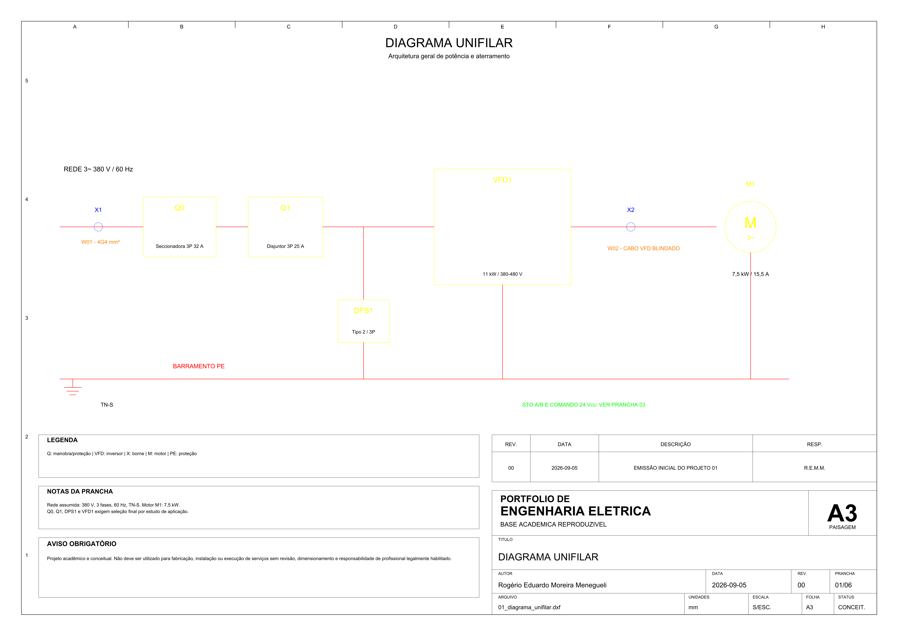
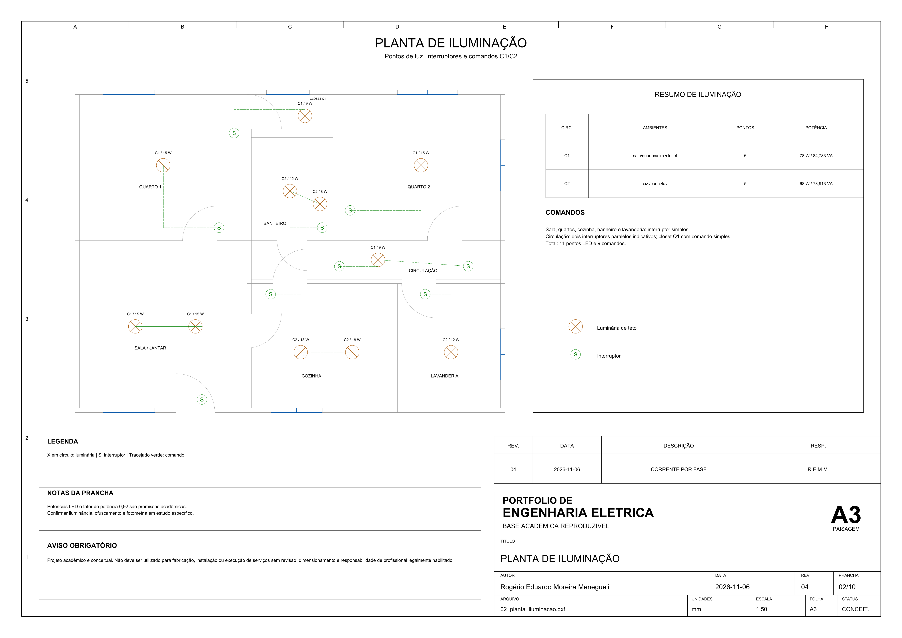
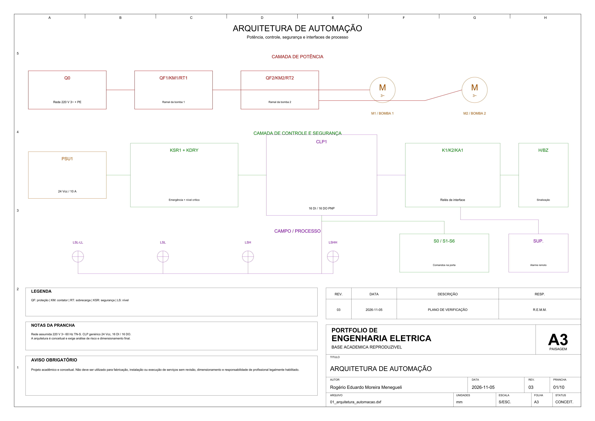
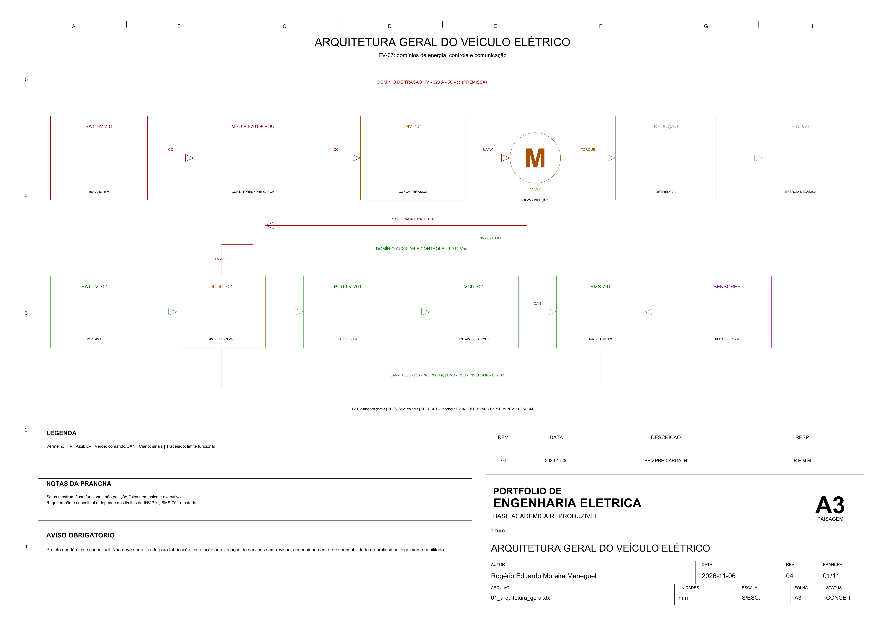

# Portfólio de Engenharia Elétrica em AutoCAD

Portfólio técnico e acadêmico de **Rogério Eduardo Moreira Menegueli**, formado por
doze estudos conceituais de documentação elétrica. O repositório reúne diagramas,
plantas, layouts, cálculos, tabelas e memoriais em um fluxo reproduzível, com DXF
verdadeiro como fonte CAD e PDF, SVG e PNG como formatos de apresentação.

**Objetivo profissional:** apresentar competências em documentação de projetos
elétricos, automação, instrumentação, acionamentos, instalações, sistemas de energia
e integração eletromecânica, com rastreabilidade entre premissas, dados, desenhos e
validações.

> Projeto acadêmico e conceitual. Não deve ser utilizado para fabricação, instalação ou execução de serviços sem revisão, dimensionamento e responsabilidade de profissional legalmente habilitado.

## Navegação rápida

- [Projetos](#projetos)
- [Galeria de destaques](#galeria-de-destaques)
- [Competências demonstradas](#competências-demonstradas)
- [Tecnologias e formatos](#tecnologias-e-formatos)
- [Como abrir e reproduzir](#como-abrir-e-reproduzir)
- [Validação e relatórios](#validação-e-relatórios)

As regras permanentes estão em [AGENTS.md](AGENTS.md) e os parâmetros processáveis
em [portfolio.toml](portfolio.toml).

## Projetos

| Código | Projeto | Ênfase técnica | Pranchas | Documentação |
| :---: | --- | --- | ---: | :---: |
| P01 | Painel de motor com inversor | potência, comando, STO, bornes, campo, coordenação e verificação | 8 | [abrir](01-painel-motor-inversor/README.md) |
| P02 | Projeto elétrico residencial | iluminação, tomadas, proteção, cargas e aterramento | 9 | [abrir](02-projeto-eletrico-residencial/README.md) |
| P03 | Painel de automação com CLP | I/O, duas bombas, alternância, sequência, intertravamentos e verificação | 10 | [abrir](03-painel-automacao-clp/README.md) |
| P04 | Controle de nível de reservatório | instrumentação, malha PI, VFD, sequência e causa–efeito | 7 | [abrir](04-controle-nivel-reservatorio/README.md) |
| P05 | Instalação elétrica industrial | cargas, alimentadores, iluminação, eletrocalhas e coordenação das proteções | 8 | [abrir](05-instalacao-eletrica-industrial/README.md) |
| P06 | Centro de Controle de Motores | partida direta, reversão, VFD, STO, cabos e causa–efeito | 8 | [abrir](06-centro-controle-motores/README.md) |
| P07 | Arquitetura de veículo elétrico | tração HV, baixa tensão, CAN, V/f, FOC e matriz de falhas | 9 | [abrir](07-arquitetura-veiculo-eletrico/README.md) |
| P08 | Sistema fotovoltaico residencial | arranjo FV, proteções CC/CA, aterramento e sensibilidade de energia | 7 | [abrir](08-sistema-fotovoltaico/README.md) |
| P09 | Fonte de bancada ajustável | conversão, topologia CC/CV, medição, integração mecânica e descarga paramétrica | 9 | [abrir](09-fonte-bancada/README.md) |
| P10 | Rede de instrumentação industrial | 4–20 mA, I/O, Ethernet, cabos, qualidade de sinais e causa–efeito | 7 | [abrir](10-rede-instrumentacao-industrial/README.md) |
| P11 | Subestação de Média Tensão 13,8 kV | entrada MT, cubículos, trafo 500 kVA, QGBT e plano de dados para estudo de aterramento/SPDA | 7 | [abrir](11-subestacao-media-tensao/README.md) |
| P12 | Grupo Moto-Gerador 250 kVA com QTA | diesel de emergência, transição aberta, USCA, sequência e matriz causa–efeito | 8 | [abrir](12-grupo-gerador-qta/README.md) |

Total: **97 pranchas A3**, cada uma disponível em DXF, PDF, SVG e PNG.

## Galeria de destaques

| Painel com inversor — P01 | Projeto residencial — P02 |
| --- | --- |
| [](01-painel-motor-inversor/exports/01_diagrama_unifilar.pdf) | [](02-projeto-eletrico-residencial/exports/02_planta_iluminacao.pdf) |
| Automação com CLP — P03 | Veículo elétrico — P07 |
| [](03-painel-automacao-clp/exports/01_arquitetura_automacao.pdf) | [](07-arquitetura-veiculo-eletrico/exports/01_arquitetura_geral.pdf) |

Veja a [galeria visual comentada](docs/galeria-visual.md) para acessar também os
DXFs, SVGs e READMEs desses quatro projetos.

## Competências demonstradas

- elaboração de diagramas unifilares, multifilares, de comando, instrumentação,
  bornes e interligações;
- documentação de instalações residenciais e industriais em baixa tensão;
- painéis de acionamento, automação, CLP e Centro de Controle de Motores;
- rastreabilidade de I/O, tags, cabos, bornes, cargas, materiais e revisões;
- cálculos acadêmicos de corrente, demanda, queda de tensão, controle, pré-carga,
  sistemas fotovoltaicos e balanço de alimentação;
- organização em layers, símbolos reutilizáveis, moldura e carimbo A3;
- automação da geração, renderização, auditoria CAD e validação de consistência;
- comunicação clara de premissas, limites, riscos e dependências de engenharia.

## Tecnologias e formatos

| Tecnologia ou formato | Uso no portfólio |
| --- | --- |
| AutoCAD / AcCoreConsole 2027 | abertura e auditoria independente dos DXFs |
| DXF AC1027 / R2013 | fonte CAD principal, em milímetros |
| Python, ezdxf e NumPy | geração e validação estrutural dos desenhos |
| Matplotlib e Pillow | renderização vetorial e raster |
| pypdf, PDFium e Poppler | validação e rasterização independente dos PDFs |
| SVG e navegador Chromium | visualização vetorial e conferência cruzada |
| CSV e XLSX | dados técnicos, cálculos e listas rastreáveis |
| Git e PowerShell | reprodução, auditoria e histórico local |

O ambiente verificado e suas limitações estão no
[relatório de ferramentas](relatorio-ferramentas.md).

### Política dos formatos

- **DXF:** fonte editável e auditável; todos os desenhos usam AC1027/R2013.
- **PDF:** uma página A3 paisagem por prancha, para leitura e impressão.
- **SVG:** visualização vetorial com `viewBox` válido.
- **PNG:** inspeção raster em 300 dpi no fluxo padrão.
- **DWG:** opcional e ausente da entrega. Nunca é obtido por renomeação; só pode ser
  gerado por conversão real, assinatura válida e reabertura/auditoria.

## Como abrir e reproduzir

Para consulta rápida, abra o PDF no leitor de sua preferência, o SVG em um navegador
ou o PNG diretamente. Para edição, abra o DXF em AutoCAD 2013 ou posterior, ou em
outro CAD com suporte comprovado a DXF AC1027. Consulte sempre as unidades e a revisão
no carimbo.

Requer Python 3.11 ou superior. No PowerShell, a partir da raiz:

```powershell
py -m venv .venv
.\.venv\Scripts\python.exe -m pip install --upgrade pip
.\.venv\Scripts\python.exe -m pip install -r .\requirements.txt
```

Reconstrução completa e validação estrita:

```powershell
.\.venv\Scripts\python.exe .\scripts\construir.py --root . --strict
```

Auditorias complementares da revisão consolidada:

```powershell
.\.venv\Scripts\python.exe .\scripts\revisar_portfolio.py --root .
.\.venv\Scripts\python.exe .\scripts\revisar_workbooks.py --root .
```

Para atualizar apenas uma folha, use o ID correspondente em `portfolio.toml`. As
entradas não selecionadas só são mantidas no manifesto quando suas fontes e saídas
continuam com os hashes registrados:

```powershell
.\.venv\Scripts\python.exe .\scripts\renderizar.py --root . --artifact p12-07-sequencia-transferencia-qta
```

Todas as dependências usadas pelos comandos públicos estão fixadas em
`requirements.txt`. O gerador de cada projeto e seus comandos específicos constam no
README individual.

## Validação e relatórios

A revisão consolidada de 2026-09-10 cobre P01–P10 (68 pranchas) e é histórica. Esta
revisão cobre 97 pranchas A3 de P01–P12. A validação estrita passou por 529.645
verificações, sem erros nem avisos; o revisor confirmou 12 projetos, 97 pranchas,
388 arquivos gráficos e 69 CSVs, com similaridade mínima PDF/PNG de 0,984061.
Consulte o [relatório de auditoria e limitações](docs/auditoria-portfolio-2026-11.md)
para escopo, conclusões visuais e limites técnicos.

- [Relatório histórico de validação](relatorio-validacao.md)
- [Revisão técnica](relatorio-revisao-tecnica.md)
- [Revisão visual histórica](relatorio-revisao-visual.md)
- [Auditoria de projetos, maturidade e correções](docs/auditoria-portfolio-2026-11.md)
- [Preparação para publicação no GitHub](relatorio-publicacao-github.md)
- [Inventário de arquivos](inventario-arquivos.md)
- [Critérios técnicos](docs/criterios-tecnicos.md)
- [Padrão gráfico](docs/padrao-grafico.md)
- [Plano dos projetos](docs/plano-projetos.md)

O validador comum verifica integridade de DXF, arquivos vazios, contratos de projeto,
layers, dimensões, moldura, elementos fora da folha, textos potencialmente
sobrepostos, PDFs, SVGs, PNGs, links relativos, temporários, manifesto e política de
DWG. Os validadores P02–P12 acrescentam invariantes técnicos próprios; P01 é coberto
pelo validador comum. Aprovação estrutural e gráfica não representa validação técnica
profissional.

## Estrutura resumida

```text
portfolio-autocad-engenharia-eletrica/
├── 01-painel-motor-inversor/ ... 12-grupo-gerador-qta/
│   ├── fonte/                  # DXFs e scripts-fonte
│   ├── exports/                # PDF, SVG e PNG
│   ├── README.md, memorial, critérios e memórias
│   └── listas CSV e relatórios processáveis
├── docs/                       # padrão, critérios, plano e galeria
├── templates/                  # template e carimbo A3 em DXF/SVG
├── renders/                    # visualizações do template e manifesto
├── scripts/                    # geração, renderização, revisão e validação
├── tests/                      # testes automatizados do validador
├── AGENTS.md
└── portfolio.toml
```

## Limites de uso

Os valores, topologias e componentes são acadêmicos, fictícios ou premissas
declaradas. A documentação não inclui levantamento de campo, seleção final de
fabricantes, responsabilidade técnica, certificação, aprovação de concessionária,
análise de risco completa, coordenação integral de proteção ou liberação executiva.

Este repositório não contém CPF, RG, telefone ou endereço residencial do autor. As
condições de reutilização estão em [LICENSE](LICENSE).
