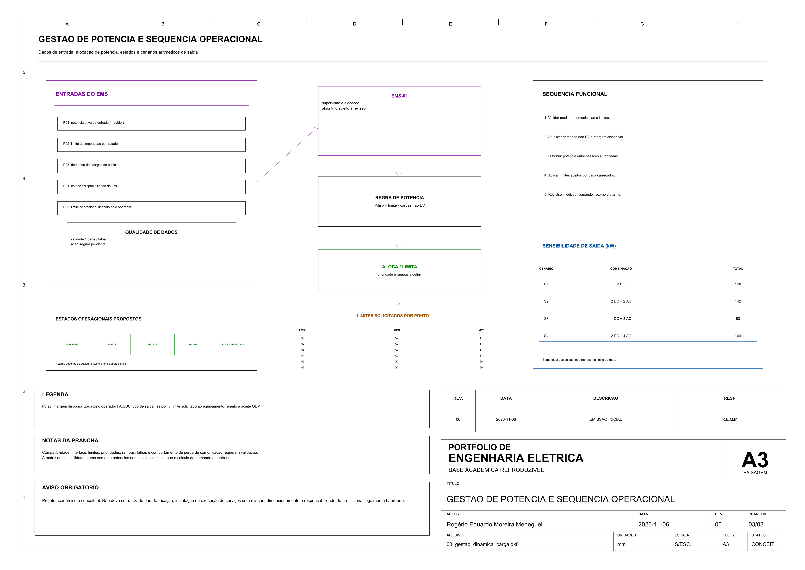
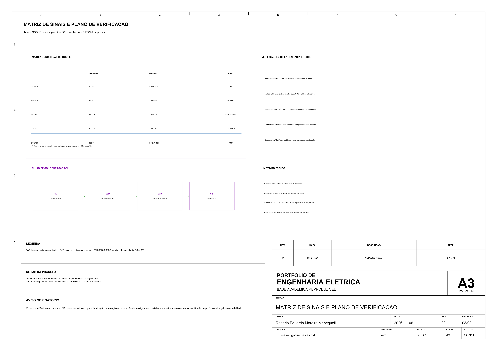
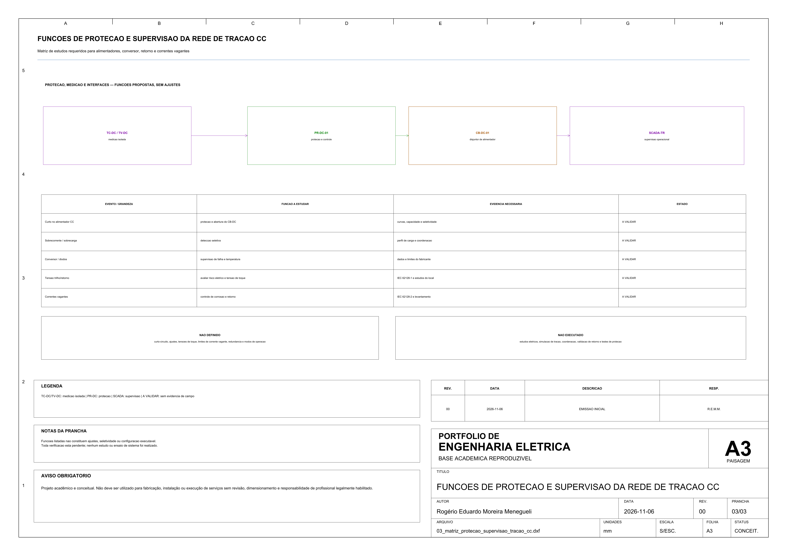
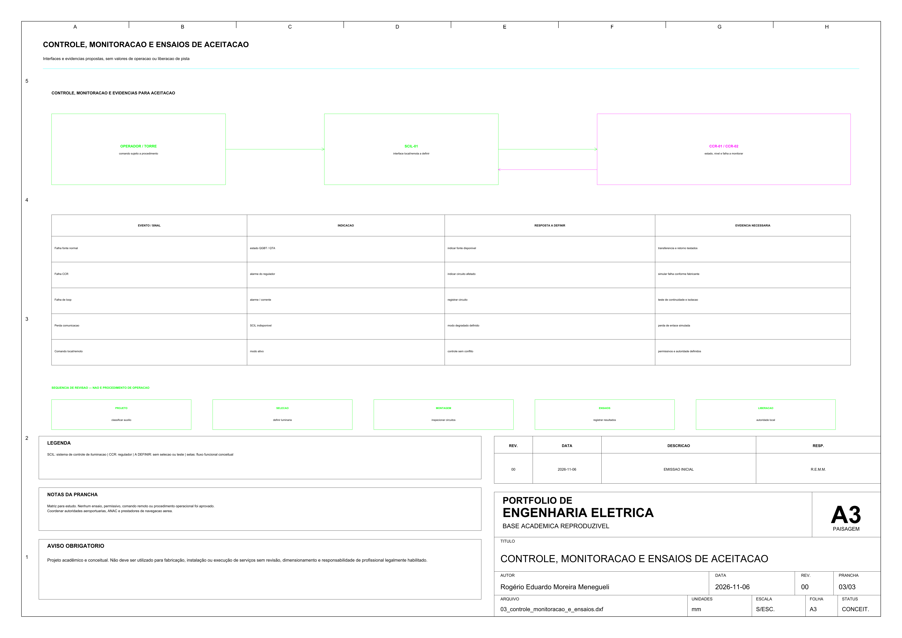
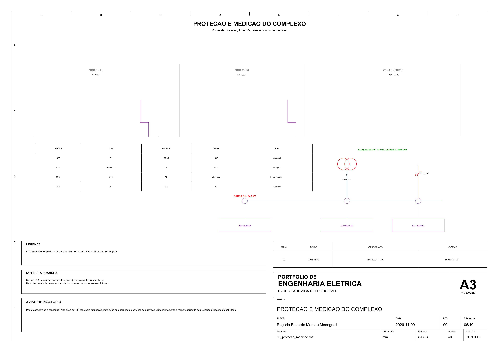
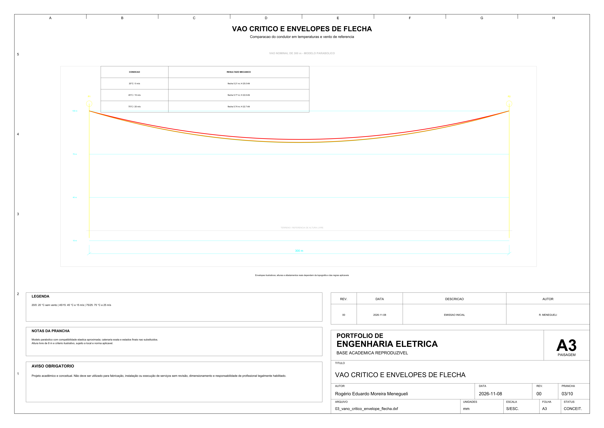
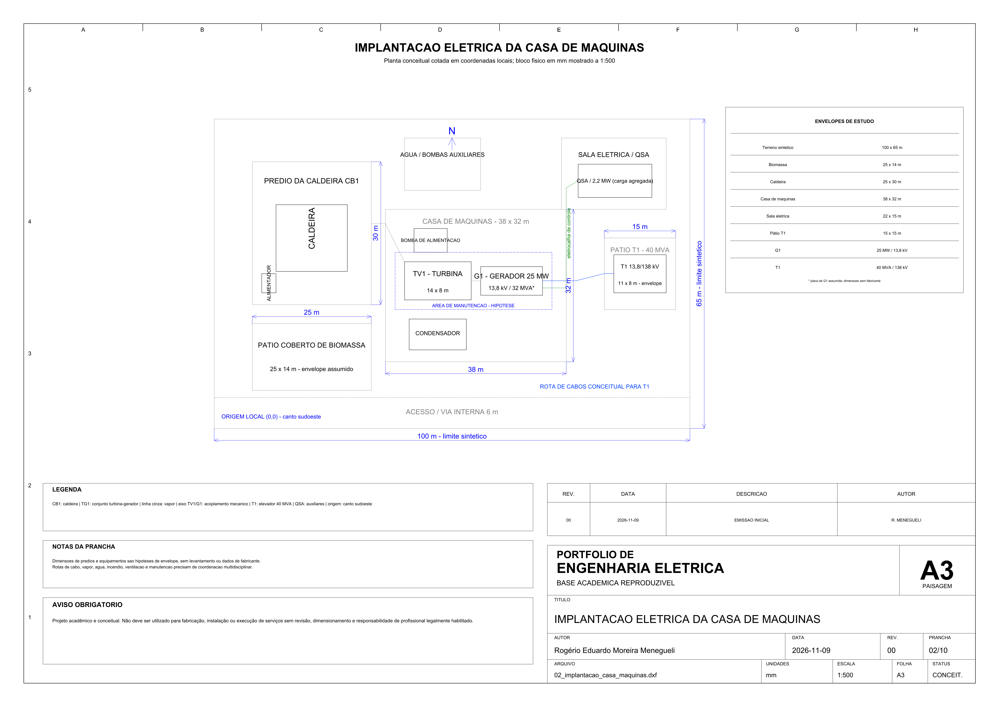

# Portfólio de Engenharia Elétrica em AutoCAD

Este repositório reúne 25 estudos acadêmicos e conceituais de instalações, painéis, automação, energia e mobilidade elétrica. O conjunto tem 140 pranchas A3: DXF editável para consulta e edição, com versões em PDF, SVG e PNG para leitura.

Cada pasta descreve as premissas usadas, os arquivos incluídos e os limites do respectivo estudo. Os desenhos não são projetos liberados para construção ou instalação.


## Navegação rápida

- [Projetos](#projetos)
- [Galeria de destaques](#galeria-de-destaques)
- [Conteúdo dos projetos](#conteúdo-dos-projetos)
- [Tecnologias e formatos](#tecnologias-e-formatos)
- [Como abrir e reproduzir](#como-abrir-e-reproduzir)
- [Validação e relatórios](#validação-e-relatórios)

Os critérios de desenho e documentação estão em [docs/padrao-grafico.md](docs/padrao-grafico.md) e [docs/criterios-tecnicos.md](docs/criterios-tecnicos.md); os parâmetros processáveis estão em [portfolio.toml](portfolio.toml).

## Projetos

| Código | Projeto | Ênfase técnica | Pranchas | Documentação |
| :---: | --- | --- | ---: | :---: |
| P25 | Usina de cogeração a biomassa | gerador síncrono 25 MW, AVR/governador, balanço elétrico e térmico, conexão em 138 kV | 10 | [abrir](25-usina-cogeracao-biomassa/README.md) |
| P24 | Linha de transmissão aérea 138 kV / 30 km | fluxo nominal π, flecha/tração, ampacidade, estruturas e aterramento conceituais | 10 | [abrir](24-linha-transmissao-138kv/README.md) |
| P23 | Complexo siderúrgico com forno EAF | 138/34,5 kV, forno 30 MVA, curto-circuito, STATCOM e harmônicos | 10 | [abrir](23-complexo-siderurgico-eaf/README.md) |
| P22 | Auxílios visuais luminosos de aeródromo | implantação indicativa, circuitos série com CCR, monitoramento e evidências de aceitação | 3 | [abrir](22-auxilios-visuais-luminosos-aerodromo/README.md) |
| P21 | Instalação elétrica de clínica ambulatorial | planta elétrica, rede normal, gerador, QTA, UPS e matriz de continuidade | 3 | [abrir](21-instalacao-clinica-ambulatorial/README.md) |
| P20 | Subestação de tração ferroviária em corrente contínua | retificação, terceiro trilho, retorno de corrente, proteção e supervisão | 3 | [abrir](20-tracao-ferroviaria-cc-750v/README.md) |
| P19 | Alimentação elétrica de navios no cais (HVSC) | interface porto/navio, transformação 13,8/6,6 kV, implantação e permissivos | 3 | [abrir](19-alimentacao-navios-cais-hvsc/README.md) |
| P18 | Compensação de reativos e qualidade de energia | correção de FP, degraus automáticos, medição no PCC e avaliação de harmônicos | 3 | [abrir](18-compensacao-reativos-qualidade-energia/README.md) |
| P17 | Automação digital de subestação com IEC 61850 | proteção e controle, redes de processo e estação, SV, GOOSE, MMS, SCL e plano de ensaio | 3 | [abrir](17-automacao-subestacao-digital/README.md) |
| P16 | Parque eólico: coleta elétrica e conexão à rede | aerogeradores, coleta em 34,5 kV, subestação elevadora, POI, cálculos e interfaces | 3 | [abrir](16-parque-eolico-coleta-conexao/README.md) |
| P15 | Microrrede industrial com FV, BESS e gerador | interconexão, balanços em ilha, armazenamento e prioridades de carga | 3 | [abrir](15-microrrede-industrial-fv-bess-gerador/README.md) |
| P14 | Infraestrutura elétrica de data center | caminhos A/B, UPS modular N+1, geração, racks dual-cord, balanço e contingências | 3 | [abrir](14-infraestrutura-eletrica-data-center/README.md) |
| P13 | Estação de recarga de veículos elétricos | implantação, recarga AC/DC, unifilar, medição e gestão dinâmica de potência | 3 | [abrir](13-estacao-recarga-veiculos-eletricos/README.md) |
| P01 | Painel de motor com inversor | potência, comando, STO, bornes e campo | 6 | [abrir](01-painel-motor-inversor/README.md) |
| P02 | Projeto elétrico residencial | iluminação, tomadas, proteção, cargas e aterramento | 8 | [abrir](02-projeto-eletrico-residencial/README.md) |
| P03 | Painel de automação com CLP | I/O, duas bombas, alternância e segurança | 8 | [abrir](03-painel-automacao-clp/README.md) |
| P04 | Controle de nível de reservatório | instrumentação, malha PI, VFD e intertravamentos | 6 | [abrir](04-controle-nivel-reservatorio/README.md) |
| P05 | Instalação elétrica industrial | cargas, alimentadores, iluminação e eletrocalhas | 7 | [abrir](05-instalacao-eletrica-industrial/README.md) |
| P06 | Centro de Controle de Motores | partida direta, reversão, VFD, STO e cabos | 7 | [abrir](06-centro-controle-motores/README.md) |
| P07 | Arquitetura de veículo elétrico | tração HV, baixa tensão, CAN, V/f e FOC | 8 | [abrir](07-arquitetura-veiculo-eletrico/README.md) |
| P08 | Sistema fotovoltaico residencial | arranjo FV, proteções CC/CA e aterramento | 6 | [abrir](08-sistema-fotovoltaico/README.md) |
| P09 | Fonte de bancada ajustável | conversão, regulação, medição e integração mecânica | 6 | [abrir](09-fonte-bancada/README.md) |
| P10 | Rede de instrumentação industrial | 4–20 mA, I/O, Ethernet, cabos e bornes | 6 | [abrir](10-rede-instrumentacao-industrial/README.md) |
| P11 | Subestação de Média Tensão 13,8 kV | entrada MT, cubículos, trafo 500 kVA, QGBT, malha NBR 15751 e SPDA NBR 5419 | 6 | [abrir](11-subestacao-media-tensao/README.md) |
| P12 | Grupo Moto-Gerador 250 kVA com QTA | diesel de emergência, transição aberta, USCA, barramento 500 A e acústica | 6 | [abrir](12-grupo-gerador-qta/README.md) |

Total: **140 pranchas A3**, cada uma disponível em DXF, PDF, SVG e PNG.

## Galeria de destaques

A seleção abaixo apresenta pranchas de referência. Clique em uma imagem para abrir o PDF A3.

| P13 — Gestão de potência | P17 — Verificação IEC 61850 |
| --- | --- |
| [](13-estacao-recarga-veiculos-eletricos/exports/03_gestao_dinamica_carga.pdf) | [](17-automacao-subestacao-digital/exports/03_matriz_goose_testes.pdf) |
| [Projeto](13-estacao-recarga-veiculos-eletricos/README.md) · [DXF](13-estacao-recarga-veiculos-eletricos/fonte/03_gestao_dinamica_carga.dxf) | [Projeto](17-automacao-subestacao-digital/README.md) · [DXF](17-automacao-subestacao-digital/fonte/03_matriz_goose_testes.dxf) |
| P20 — Proteção da tração CC | P22 — Controle e aceitação |
| [](20-tracao-ferroviaria-cc-750v/exports/03_matriz_protecao_supervisao_tracao_cc.pdf) | [](22-auxilios-visuais-luminosos-aerodromo/exports/03_controle_monitoracao_e_ensaios.pdf) |
| [Projeto](20-tracao-ferroviaria-cc-750v/README.md) · [DXF](20-tracao-ferroviaria-cc-750v/fonte/03_matriz_protecao_supervisao_tracao_cc.dxf) | [Projeto](22-auxilios-visuais-luminosos-aerodromo/README.md) · [DXF](22-auxilios-visuais-luminosos-aerodromo/fonte/03_controle_monitoracao_e_ensaios.dxf) |

A [galeria comentada](docs/galeria-visual.md) reúne as mesmas prévias e links diretos para os arquivos.

### Estudos P23–P25

| P23 — Proteção e medição | P24 — Vão crítico e flecha | P25 — Implantação da casa de máquinas |
| --- | --- | --- |
| [](23-complexo-siderurgico-eaf/exports/06_protecao_medicao.pdf) | [](24-linha-transmissao-138kv/exports/03_vano_critico_envelope_flecha.pdf) | [](25-usina-cogeracao-biomassa/exports/02_implantacao_casa_maquinas.pdf) |
| [Projeto](23-complexo-siderurgico-eaf/README.md) · [DXF](23-complexo-siderurgico-eaf/fonte/06_protecao_medicao.dxf) | [Projeto](24-linha-transmissao-138kv/README.md) · [DXF](24-linha-transmissao-138kv/fonte/03_vano_critico_envelope_flecha.dxf) | [Projeto](25-usina-cogeracao-biomassa/README.md) · [DXF](25-usina-cogeracao-biomassa/fonte/02_implantacao_casa_maquinas.dxf) |

## Conteúdo dos projetos

Os desenhos cobrem diagramas unifilares e funcionais, plantas, painéis, instrumentação, alimentação, proteção e controle. Os memoriais de cada pasta explicam quais valores são premissas e quais estudos ainda seriam necessários.


## Tecnologias e formatos

| Tecnologia ou formato | Uso no portfólio |
| --- | --- |
| AutoCAD | abertura e edição dos DXFs |
| DXF AC1027 / R2013 | fonte CAD principal, em milímetros |
| Python, ezdxf e NumPy | geração e validação estrutural dos desenhos |
| MATLAB R2026a e Simulink | cálculos P23–P25 e modelos dinâmicos P23/P25 |
| Matplotlib e Pillow | renderização vetorial e raster |
| pypdf, PDFium e Poppler | validação e rasterização independente dos PDFs |
| SVG e navegador Chromium | visualização vetorial e conferência cruzada |
| CSV e XLSX | dados técnicos, cálculos e listas rastreáveis |
| Git e PowerShell | reprodução, auditoria e histórico local |

A reprodução e o estado das verificações estão em [Ferramentas e validação](relatorio-ferramentas.md) e no [relatório consolidado](relatorio-validacao.md).

### Política dos formatos

- **DXF:** fonte editável e auditável; todos os desenhos usam AC1027/R2013.
- **PDF:** uma página A3 paisagem por prancha, para leitura e impressão.
- **SVG:** visualização vetorial com `viewBox` válido.
- **PNG:** inspeção raster em 300 dpi no fluxo padrão.
- **DWG:** opcional e ausente da entrega. Nunca é obtido por renomeação; só pode ser
  gerado por conversão real, assinatura válida e reabertura/auditoria.

## Como abrir e reproduzir

Para consulta rápida, abra o PDF no leitor de sua preferência, o SVG em um navegador
ou o PNG diretamente. Para edição, abra o DXF em AutoCAD 2013 ou posterior, ou em
outro CAD com suporte comprovado a DXF AC1027. Consulte sempre as unidades e a revisão
no carimbo.

Requer Python 3.11 ou superior. No PowerShell, a partir da raiz:

```powershell
py -m venv .venv
.\.venv\Scripts\python.exe -m pip install --upgrade pip
.\.venv\Scripts\python.exe -m pip install -r .\requirements.txt
```

Reconstrução completa e validação estrita:

```powershell
.\.venv\Scripts\python.exe .\scripts\construir.py --root . --strict
```

Auditorias complementares da revisão consolidada:

```powershell
.\.venv\Scripts\python.exe .\scripts\revisar_portfolio.py --root .
.\.venv\Scripts\python.exe .\scripts\revisar_workbooks.py --root .
```

Todas as dependências usadas pelos comandos públicos estão fixadas em
`requirements.txt`. Para reproduzir as três novas entregas, os geradores e análises
estão nos respectivos READMEs. Os modelos Simulink entregues para P23 e P25 usam
blocos padrão; o registro histórico de 08/11 marcou Simscape Electrical como não
licenciado, e essa licença não foi reconsultada em 09/11.

## Validação e relatórios

A auditoria desta branch registra 36 testes Python aprovados, 651.139 verificações estruturais sem erros ou avisos e uma evidência versionada de 30/30 DXFs aprovados pelo AutoCAD Core Console. A auditoria também registra caminhos estáticos MATLAB executados para P23–P25. As rotinas dinâmicas MATLAB/Simulink não têm execução bem-sucedida confirmada: P23 foi interrompido antes de produzir simulação, P24 não possui modelo Simulink e P25 não foi iniciado. Consulte o [relatório final](RELATORIO_FINAL_AUDITORIA_P23_P24_P25.md) para escopo, premissas e limitações. Esses testes não certificam engenharia.

Na triagem atual P24, a maior corrente calculada é 650,80 A e a ampacidade mínima estimada do feixe é 892,04 A nas premissas cadastradas. Esse resultado não confirma capacidade normativa ou de campo: os dados de clima, rota e cabo permanecem sintéticos.

- [Relatório de validação (histórico P01–P10 e estado atual P01–P25)](relatorio-validacao.md)
- [Revisão técnica](relatorio-revisao-tecnica.md)
- [Revisão visual](relatorio-revisao-visual.md)
- [Inventário de arquivos](inventario-arquivos.md)
- [Critérios técnicos](docs/criterios-tecnicos.md)
- [Padrão gráfico](docs/padrao-grafico.md)


## Estrutura resumida

```text
portfolio-autocad-engenharia-eletrica/
├── 01-painel-motor-inversor/ ... 25-usina-cogeracao-biomassa/
│   ├── fonte/                  # DXFs e scripts-fonte
│   ├── exports/                # PDF, SVG e PNG
│   ├── README.md, memorial, critérios e memórias
│   └── listas CSV e relatórios processáveis
├── docs/                       # padrão, critérios, plano e galeria
├── projetos/README.md          # guia de compatibilidade e links para os projetos
├── templates/                  # template e carimbo A3 em DXF/SVG
├── renders/                    # visualizações do template e manifesto
├── scripts/                    # geração, renderização, revisão e validação
├── tests/                      # testes automatizados do validador
└── portfolio.toml
```

## Limites de uso

Os valores, topologias e componentes são acadêmicos, fictícios ou premissas
declaradas. A documentação não inclui levantamento de campo, seleção final de
fabricantes, responsabilidade técnica, certificação, aprovação de concessionária,
análise de risco completa, coordenação integral de proteção ou liberação executiva.

As condições de reutilização estão em [LICENSE](LICENSE).
