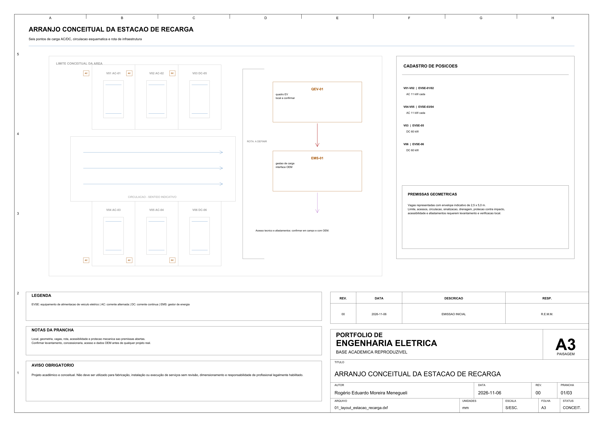
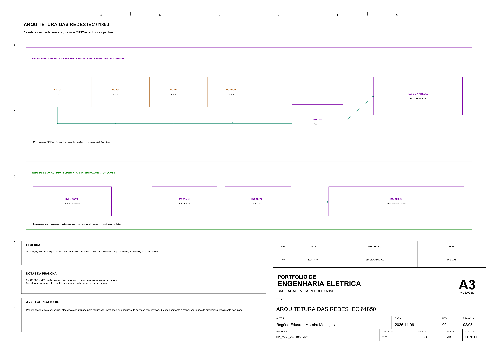
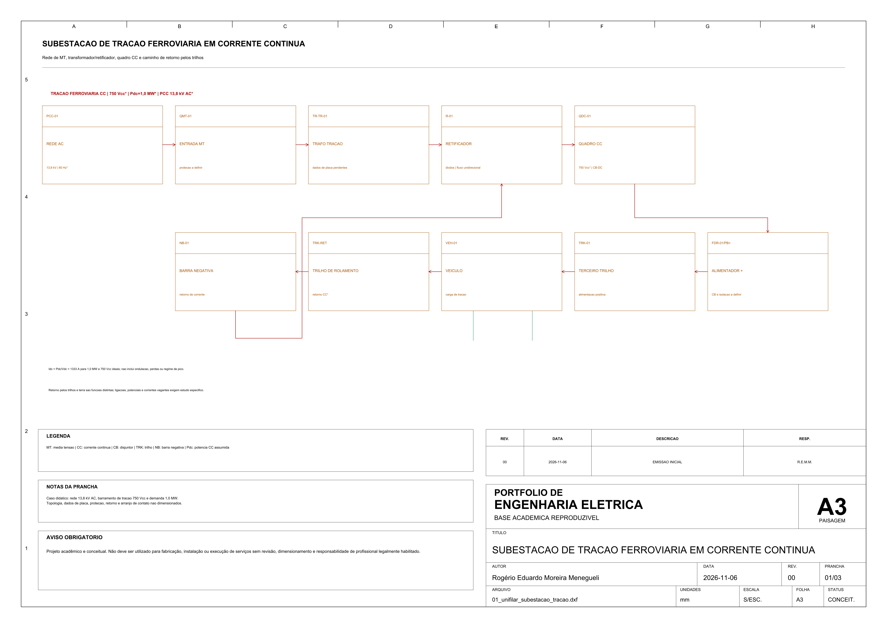
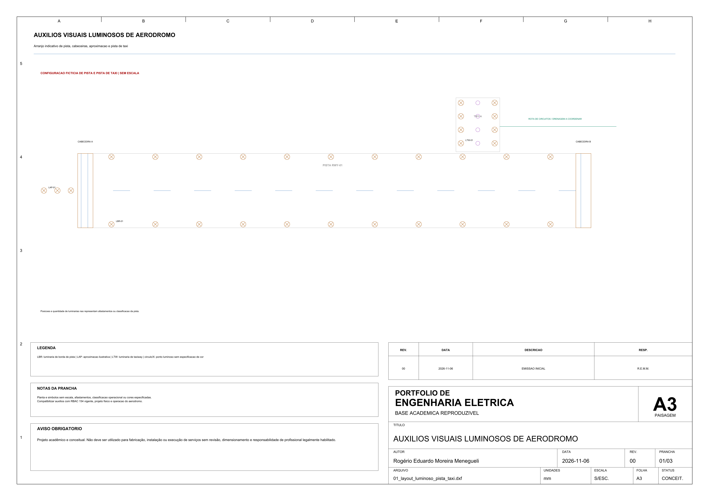

# Galeria visual do portfólio

Quatro pranchas dos projetos P13, P17, P20 e P22. Cada imagem é uma prévia PNG; o clique abre o PDF correspondente.

| P13 — Estação de recarga | P17 — Automação IEC 61850 |
| --- | --- |
|  |  |
| Implantação esquemática com seis posições. [Projeto](../13-estacao-recarga-veiculos-eletricos/README.md) · [DXF](../13-estacao-recarga-veiculos-eletricos/fonte/01_layout_estacao_recarga.dxf) | Redes de processo e de estação em um exemplo conceitual. [Projeto](../17-automacao-subestacao-digital/README.md) · [DXF](../17-automacao-subestacao-digital/fonte/02_rede_iec61850.dxf) |
| P20 — Tração ferroviária CC | P22 — Auxílios visuais de aeródromo |
|  |  |
| Unifilar conceitual de conversão CA/CC e retorno. [Projeto](../20-tracao-ferroviaria-cc-750v/README.md) · [DXF](../20-tracao-ferroviaria-cc-750v/fonte/01_unifilar_subestacao_tracao.dxf) | Arranjo indicativo, sem escala ou classificação operacional. [Projeto](../22-auxilios-visuais-luminosos-aerodromo/README.md) · [DXF](../22-auxilios-visuais-luminosos-aerodromo/fonte/01_layout_luminoso_pista_taxi.dxf) |

A seleção é um ponto de entrada para a coleção, não uma amostra de validação. O README e os registros de cada pasta descrevem premissas e limites.
