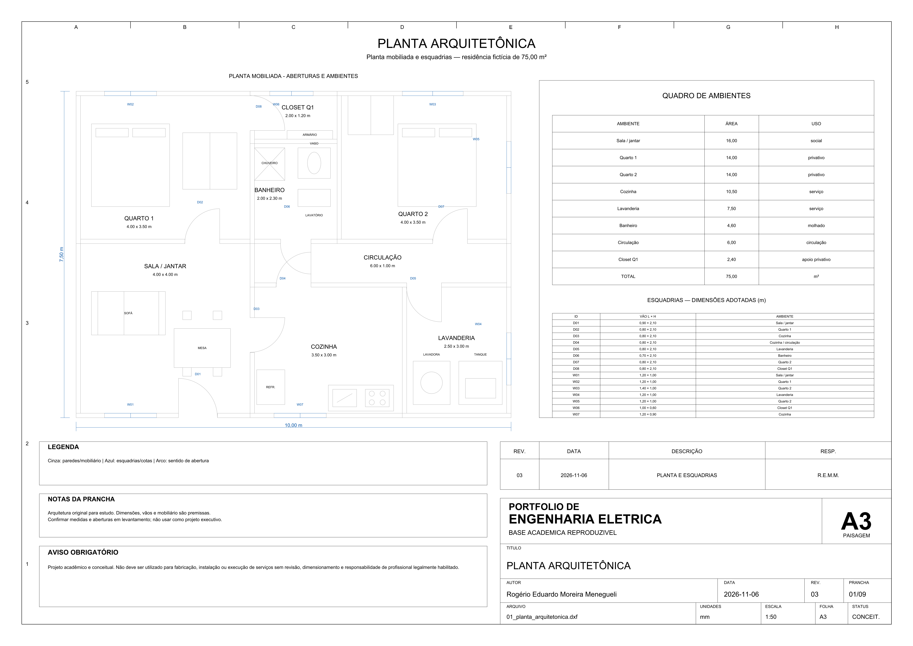
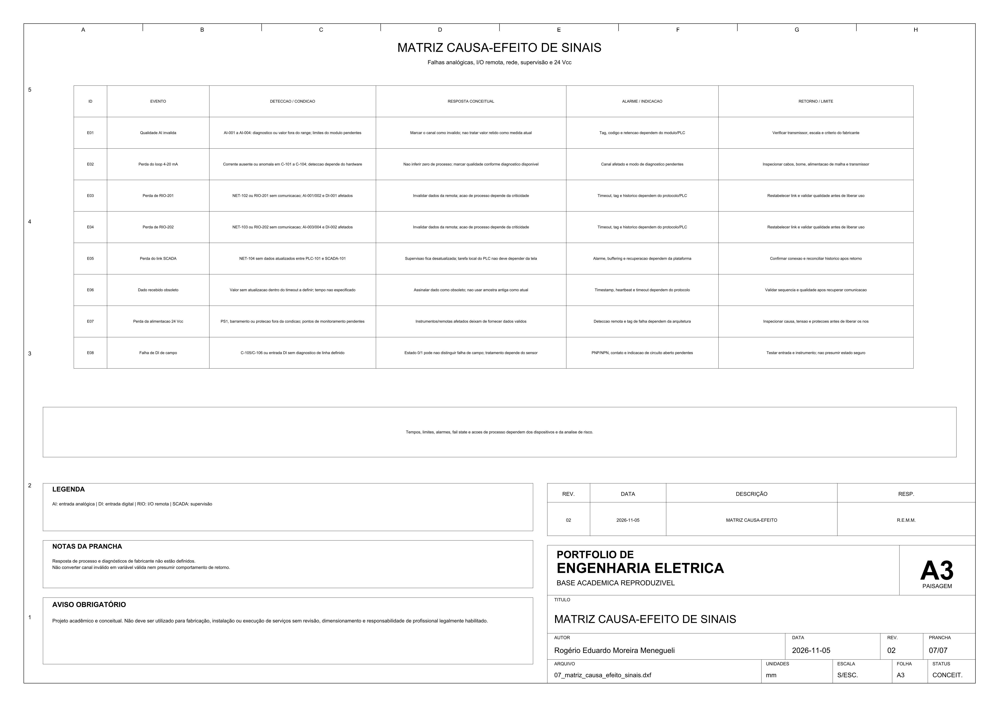
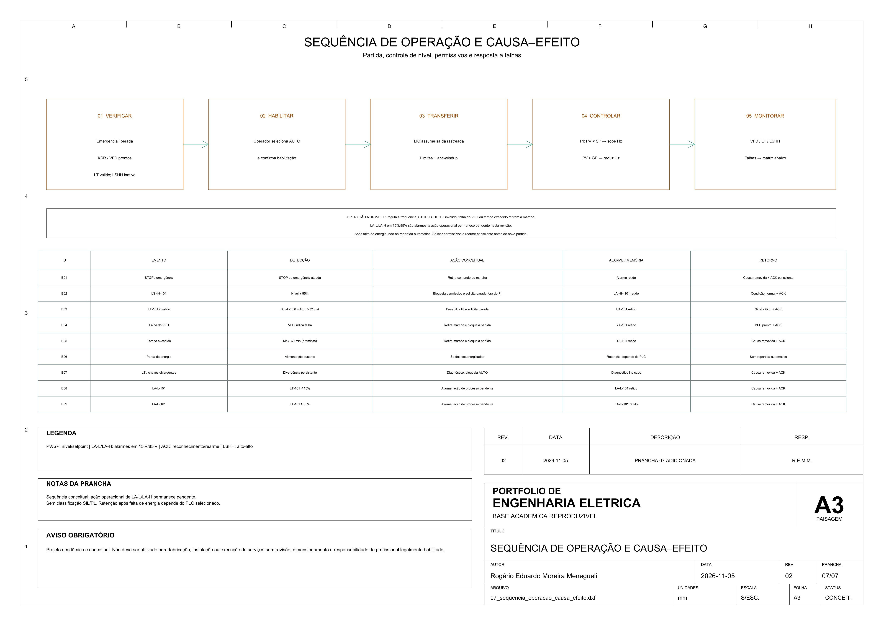
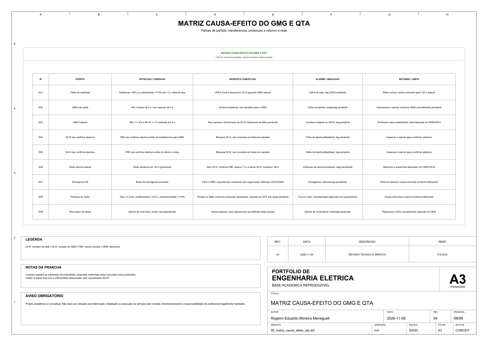

# Galeria visual do portfólio

Esta seleção apresenta seis pranchas representativas da variedade do portfólio.
Cada imagem é um PNG de inspeção gerado a partir do mesmo DXF que origina o PDF e o
SVG. Clique na imagem para abrir o PDF A3.

| P01 — Painel com inversor | P02 — Projeto residencial |
| --- | --- |
|  |  |
| Potência, proteção, inversor, motor e aterramento. [Projeto](../01-painel-motor-inversor/README.md) · [DXF](../01-painel-motor-inversor/fonte/01_diagrama_unifilar.dxf) · [SVG](../01-painel-motor-inversor/exports/01_diagrama_unifilar.svg) | Planta mobiliada, vãos identificados e quadro de esquadrias; arquitetura, dimensões e móveis seguem premissas. [Projeto](../02-projeto-eletrico-residencial/README.md) · [DXF](../02-projeto-eletrico-residencial/fonte/01_planta_arquitetonica.dxf) · [SVG](../02-projeto-eletrico-residencial/exports/01_planta_arquitetonica.svg) |
| P03 — Automação com CLP | P10 — Instrumentação e sinais |
|  |  |
| Potência, segurança, CLP, processo e sinalização. [Projeto](../03-painel-automacao-clp/README.md) · [DXF](../03-painel-automacao-clp/fonte/01_arquitetura_automacao.dxf) · [SVG](../03-painel-automacao-clp/exports/01_arquitetura_automacao.svg) | Qualidade de AI/DI, perda de remotas e supervisão; respostas dependentes do hardware ficam explícitas. [Projeto](../10-rede-instrumentacao-industrial/README.md) · [DXF](../10-rede-instrumentacao-industrial/fonte/07_matriz_causa_efeito_sinais.dxf) · [SVG](../10-rede-instrumentacao-industrial/exports/07_matriz_causa_efeito_sinais.svg) |
| P04 — Nível e causa–efeito | P12 — Matriz do GMG/QTA |
|  |  |
| Partida, regulação PI, permissivos e sete respostas a falhas. [Projeto](../04-controle-nivel-reservatorio/README.md) · [DXF](../04-controle-nivel-reservatorio/fonte/07_sequencia_operacao_causa_efeito.dxf) · [SVG](../04-controle-nivel-reservatorio/exports/07_sequencia_operacao_causa_efeito.svg) | Nove eventos, permissivos e respostas pendentes da USCA/OEM. [Projeto](../12-grupo-gerador-qta/README.md) · [DXF](../12-grupo-gerador-qta/fonte/08_matriz_causa_efeito_qta.dxf) · [SVG](../12-grupo-gerador-qta/exports/08_matriz_causa_efeito_qta.svg) |

## Critério da seleção

- P01 demonstra a base comum de potência, comando e documentação de painel;
- P02 mostra a aplicação do padrão gráfico a uma planta arquitetônica;
- P03 representa automação, segurança e interfaces de processo;
- P10 conecta sinais de campo e rede às limitações de diagnóstico e qualidade dos dados.
- P04 mostra sequência de operação rastreada à filosofia e premissas do processo.
- P12 demonstra como registrar eventos e limites conhecidos sem preencher respostas de fabricante ainda pendentes.

As 68 pranchas citadas no relatório abaixo pertencem à revisão histórica de P01–P10
em 2026-09-10; P11 e P12 foram adicionados depois. Consulte a
[auditoria atual do portfólio](auditoria-portfolio-2026-11.md), a
[revisão visual histórica](../relatorio-revisao-visual.md) e a
[tabela completa de projetos](../README.md#projetos).

> Projeto acadêmico e conceitual. Não deve ser utilizado para fabricação, instalação ou execução de serviços sem revisão, dimensionamento e responsabilidade de profissional legalmente habilitado.
