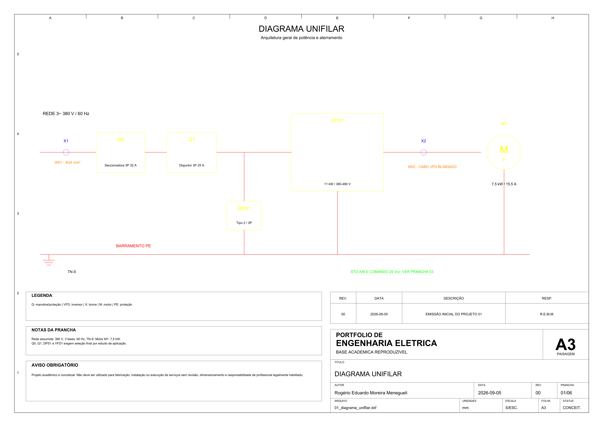
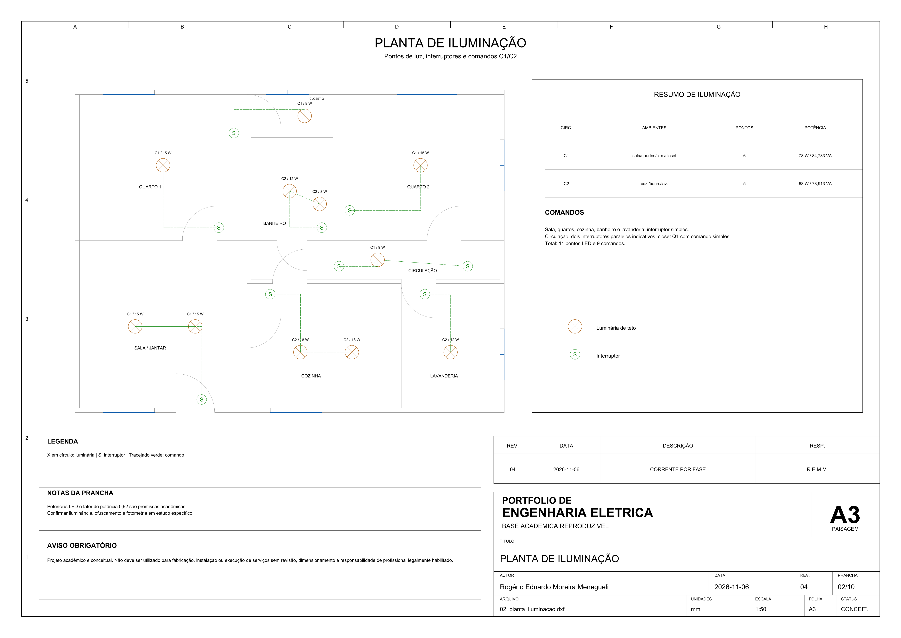
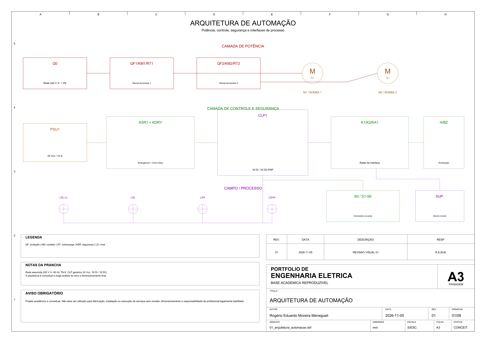
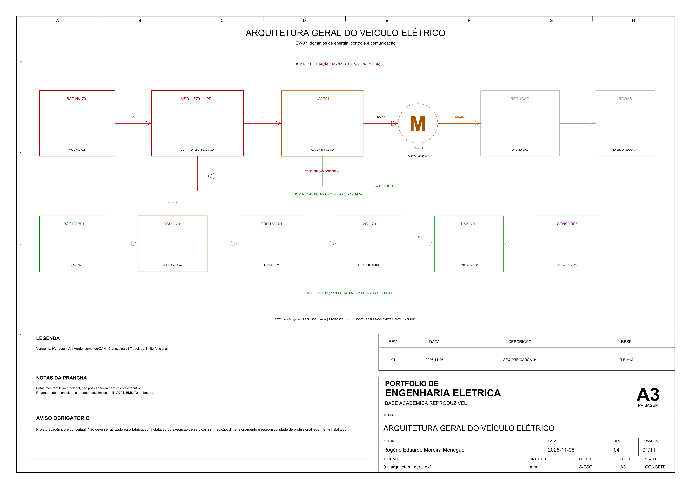

# Relatório de preparação para publicação no GitHub

**Data:** 2026-09-10

**Escopo:** branch `main`, árvore atual e histórico Git completo

**Estado:** pronto para publicação, aguardando autorização explícita

Nenhum repositório remoto foi criado, nenhum `remote` foi configurado e nenhum `push`
foi executado.

## Identidade recomendada

**Nome do repositório:** `portfolio-autocad-engenharia-eletrica`

**Descrição:** Portfólio acadêmico de Engenharia Elétrica com 68 pranchas A3 em DXF,
PDF, SVG e PNG, geradas e validadas de forma reproduzível.

**Tópicos recomendados:**

`engenharia-eletrica`, `autocad`, `dxf`, `cad`, `projetos-eletricos`,
`automacao-industrial`, `instrumentacao`, `instalacoes-eletricas`,
`sistemas-fotovoltaicos`, `veiculo-eletrico`, `python`, `ezdxf`, `portfolio`.

Os tópicos respeitam as regras atuais do GitHub: letras minúsculas, hífens, no máximo
50 caracteres por tópico e no máximo 20 tópicos. Consulte a
[documentação oficial sobre tópicos](https://docs.github.com/en/repositories/managing-your-repositorys-settings-and-features/customizing-your-repository/classifying-your-repository-with-topics).

## O que será publicado

- branch `main`, com 13 commits após o commit desta preparação;
- 471 arquivos versionados e 131.985.877 bytes (125,87 MiB) de
  conteúdo descompactado na revisão final;
- 10 projetos acadêmicos, 68 pranchas e os documentos comuns do portfólio;
- 70 DXFs, 69 PDFs, 70 SVGs, 69 PNGs, 50 CSVs e 2 XLSXs;
- scripts Python de geração, renderização, validação e auditoria;
- histórico completo desde a criação da infraestrutura.

Não serão publicados `.venv/`, `node_modules/`, caches, logs, `tmp/`, `work/`,
arquivos de IDE, credenciais ou bundles locais, pois esses caminhos estão cobertos pelo
[`.gitignore`](.gitignore) e não aparecem no conjunto versionado.

## Auditoria de privacidade e segredos

O auditor [auditar_publicacao.py](scripts/auditar_publicacao.py) examinou os arquivos
atuais, 356 links relativos e todos os blobs alcançáveis nos 12 commits anteriores à
preparação final. A execução vigente será repetida depois do commit.

| Categoria | Árvore atual | Histórico |
| --- | :---: | :---: |
| CPF válido | nenhum | nenhum |
| RG associado a valor | nenhum | nenhum |
| Telefone formatado | nenhum | nenhum |
| Endereço pessoal | nenhum | nenhum |
| E-mail em arquivos | nenhum | nenhum |
| Senha, token ou chave conhecida | nenhum | nenhum |
| Atribuição suspeita de credencial | nenhuma | nenhuma |
| Caminho absoluto local ou `file://` real | nenhum | nenhum |
| Nome de arquivo temporário ou sensível | nenhum | nenhum |

Os commits usam o nome de Rogério Eduardo Moreira Menegueli e o endereço local
mascarado `p***@localhost`. Esse endereço não é um contato pessoal publicável. Como
efeito colateral, os commits podem não ser atribuídos automaticamente ao perfil do
autor no GitHub. Para commits futuros, pode-se configurar o endereço `noreply` fornecido
pelo próprio GitHub, sem reescrever o histórico atual.

Gitleaks, TruffleHog, detect-secrets e git-secrets não estão instalados. O auditor local
usa regras explícitas para padrões brasileiros, chaves PEM, tokens conhecidos,
atribuições de credenciais, caminhos locais e nomes suspeitos. Ao publicar, recomenda-se
manter também a proteção de `push` contra segredos oferecida pelo GitHub.

## Metadados

- **PDF:** 69 arquivos com título, autor, ferramenta geradora e datas fixas; nenhum
  caminho local, e-mail ou credencial.
- **PNG:** 69 arquivos com título, autor, software e resolução; nenhum EXIF pessoal ou
  geolocalização.
- **SVG:** 70 arquivos com autor, gerador e data; sem comentários ocultos, caminhos
  locais ou e-mails.
- **DXF:** 70 arquivos com metadados técnicos normais do formato — AC1027, unidades,
  GUIDs e `LASTSAVEDBY=ezdxf`; sem nome de usuário ou diretório local.
- **XLSX:** o P04 não contém propriedades pessoais no pacote; o P05 contém apenas
  autor, título, descrição técnica e datas determinísticas.

Os nomes e versões das ferramentas são intencionais porque documentam proveniência e
reprodutibilidade. Não foram encontrados metadados confidenciais que precisassem ser
removidos.

## Tamanho e arquivos grandes

O maior blob atual é
`05-instalacao-eletrica-industrial/exports/06_quadro_cargas.svg`, com 1,33 MiB. Há 11
SVGs acima de 1 MiB, nenhum arquivo acima de 50 MiB e nenhum acima de 100 MiB, tanto na
árvore atual quanto no histórico alcançável.

Distribuição aproximada do conteúdo atual:

| Tipo | Tamanho |
| --- | ---: |
| SVG | 61,19 MiB |
| PNG | 30,84 MiB |
| PDF | 26,43 MiB |
| DXF | 6,41 MiB |
| Demais arquivos | menos de 1 MiB |

O tamanho é aceitável para o GitHub. A plataforma alerta para arquivos individuais
acima de 50 MiB, bloqueia arquivos acima de 100 MiB e recomenda manter repositórios
abaixo de 1 GiB. Consulte os [limites oficiais para arquivos e repositórios](https://docs.github.com/en/repositories/working-with-files/managing-large-files/about-large-files-on-github).

Os derivados gráficos explicam a maior parte do volume e são parte deliberada do
portfólio visual. Git LFS não é necessário nesta versão; migrá-los agora acrescentaria
complexidade sem resolver um limite real.

## Licenças e materiais de terceiros

O [licenciamento dual](LICENSE) foi conferido e seu escopo foi corrigido para as dez
pastas reais de projeto:

- MIT para scripts, testes, validadores e configurações executáveis;
- CC BY-NC 4.0 para desenhos, documentos, imagens, tabelas e artefatos acadêmicos.

As dependências Python são instaladas pelo gerenciador de pacotes e não são copiadas
para o repositório. Os metadados instalados declaram licenças permissivas como MIT,
BSD, Apache-2.0, PSF-2.0, Zlib e CC0; não foi identificada dependência incompatível com
o uso declarado. A antiga dependência privada `@oai/artifact-tool` foi removida do
HEAD e substituída por `openpyxl 3.1.5` e `et-xmlfile 2.0.0`, ambos MIT.

Como a licença do repositório é mista, o GitHub pode mostrá-la como licença não
identificada em vez de exibir um único selo. Isso é uma consequência esperada da
separação entre código e conteúdo, não uma incompatibilidade. A própria documentação
do GitHub alerta que múltiplas licenças podem dificultar a detecção automática:
[licenciamento de repositórios](https://docs.github.com/en/repositories/managing-your-repositorys-settings-and-features/customizing-your-repository/licensing-a-repository).

Não foram encontrados logotipos, fotografias, fontes, bibliotecas vendorizadas ou
trechos extensos de normas técnicas. As referências externas apontam para páginas
oficiais de ABNT, IEC, ISO, ISA, Confea, Governo Federal e Planalto; 25/25 destinos
foram conferidos em 2026-09-10. Os desenhos e imagens possuem cadeia de geração local
DXF → PDF/SVG/PNG. A auditoria técnica não substitui uma declaração humana de autoria;
antes da publicação, o autor deve confirmar que não incorporou material de terceiros
fora do que está identificado nas referências.

## Arquivos potencialmente problemáticos

Não existe bloqueador técnico conhecido. Permanecem quatro observações transparentes:

1. os 11 SVGs acima de 1 MiB são maiores que o ideal para navegação web, mas o maior
   possui apenas 1,33 MiB e nenhum se aproxima do alerta de 50 MiB;
2. o licenciamento dual pode aparecer como “Other” na interface do GitHub;
3. o e-mail `p***@localhost` é seguro, porém não associa os commits ao perfil GitHub;
4. commits anteriores conservam referências históricas ao pacote privado removido,
   mas não contêm o pacote, credenciais ou dados confidenciais. Não há motivo de
   segurança para reescrever o histórico.

## Quatro imagens principais

| P01 — painel com inversor | P02 — projeto residencial |
| --- | --- |
| [](01-painel-motor-inversor/exports/01_diagrama_unifilar.pdf) | [](02-projeto-eletrico-residencial/exports/02_planta_iluminacao.pdf) |
| P03 — painel com CLP | P07 — veículo elétrico |
| [](03-painel-automacao-clp/exports/01_arquitetura_automacao.pdf) | [](07-arquitetura-veiculo-eletrico/exports/01_arquitetura_geral.pdf) |

## Comandos de verificação

```powershell
.\.venv\Scripts\python.exe .\scripts\auditar_publicacao.py --root .
.\.venv\Scripts\python.exe .\scripts\validar_portfolio.py --root . --strict
.\.venv\Scripts\python.exe .\scripts\revisar_workbooks.py --root .
git fsck --full --strict
git status --short
```

## Ação necessária para publicar

Após criar manualmente no GitHub um repositório público **vazio**, sem README, licença
ou `.gitignore` adicionais, executar somente após autorização explícita:

```powershell
git remote add origin https://github.com/USUARIO/portfolio-autocad-engenharia-eletrica.git
git push -u origin main
```

Substitua `USUARIO` pelo proprietário real da conta. A alternativa por GitHub CLI não
foi indicada porque `gh` não está instalado neste ambiente.

> Projeto acadêmico e conceitual. Não deve ser utilizado para fabricação, instalação ou execução de serviços sem revisão, dimensionamento e responsabilidade de profissional legalmente habilitado.
